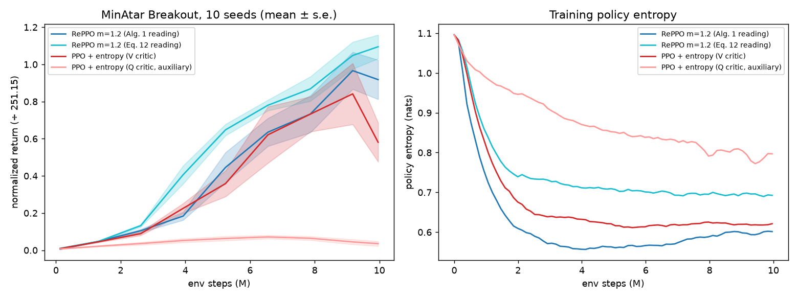
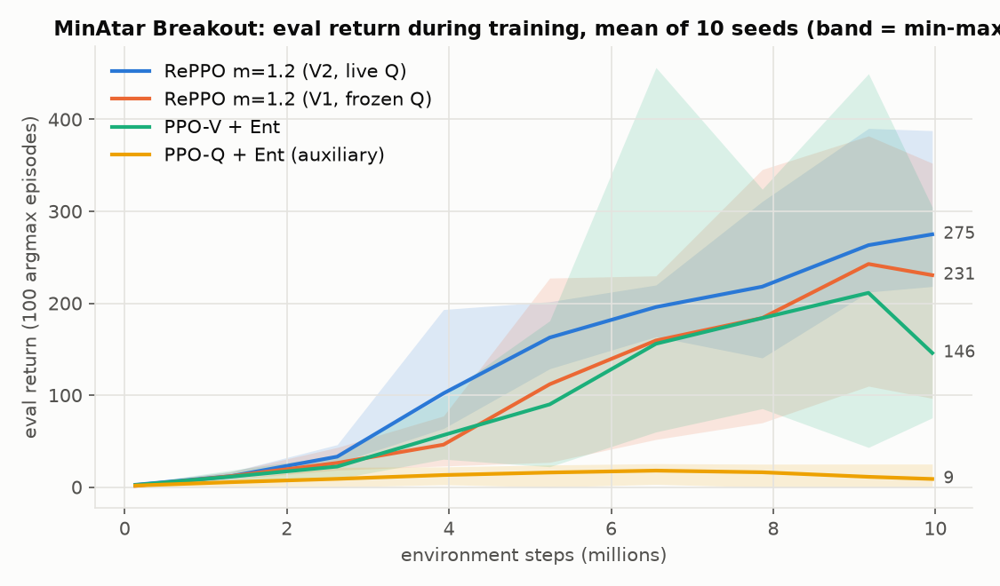
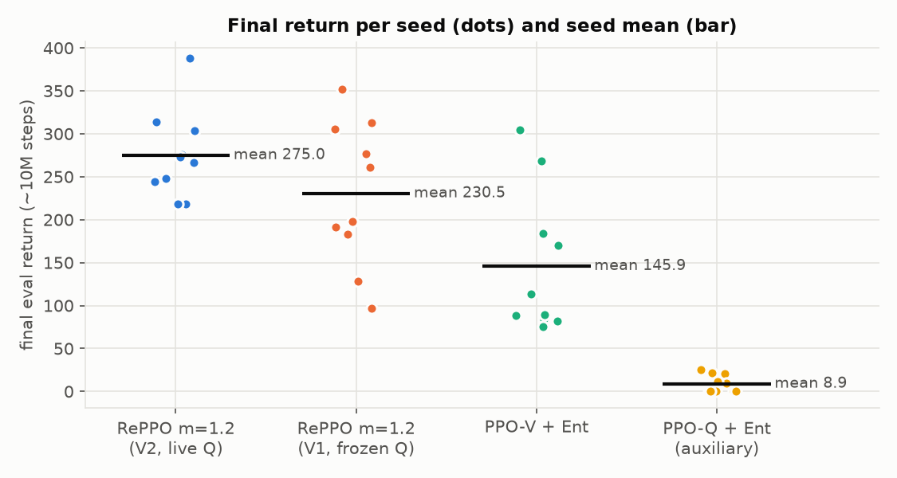
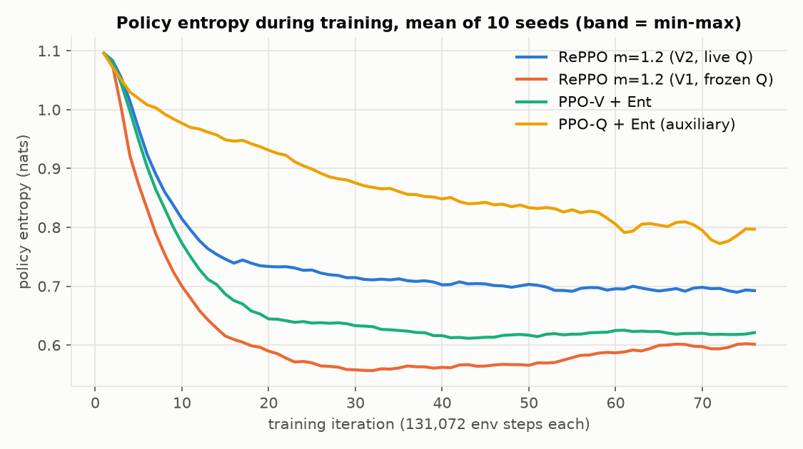
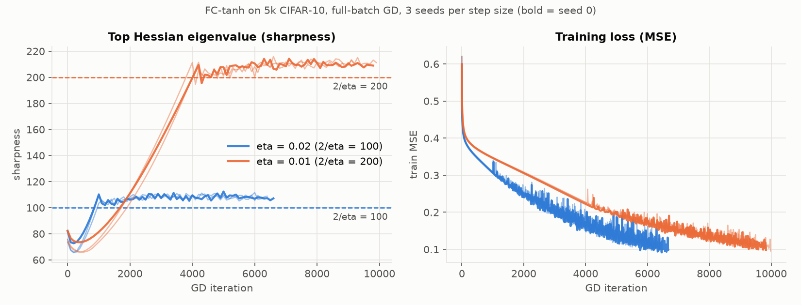
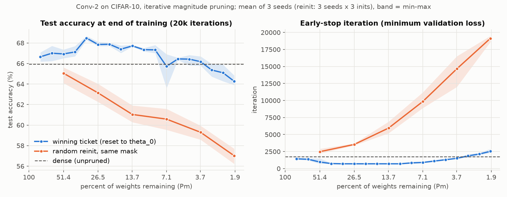
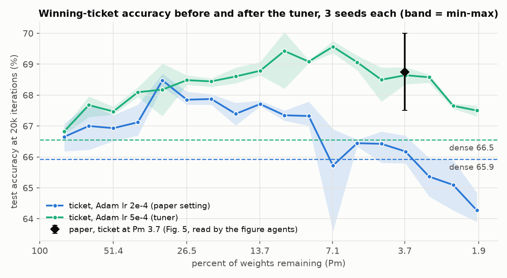
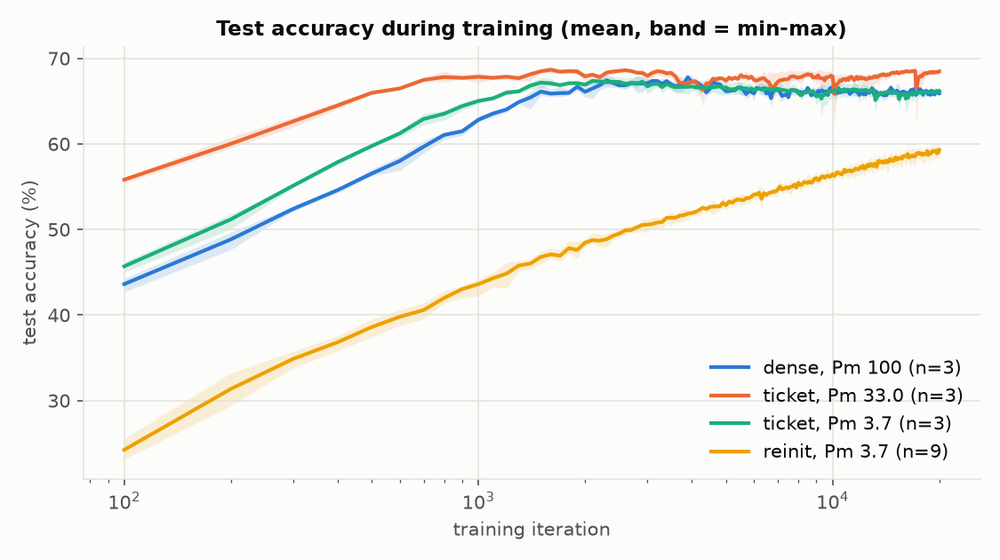

# SwarmFlow notes: reppo-retrying, edge-of-stability, lottery-ticket-small

The best SwarmFlow run on each of three papers, set against the best single-agent and cluster runs on the same papers.

| Paper | Best SwarmFlow run | Flow version | State |
|---|---|---|---|
| reppo-retrying | `runs/20261027-213301-reppo-retrying` | original 13-role flow (reader, spec, expert, planner, contracts, builders, challenger, gate, audit, judge) | finished, verdict **partial** (capped) |
| edge-of-stability | `runs/20261104-124700-edge-of-stability` | current flow (lead, figure readers, builder, reviewer, evaluator, audit, judge, tuner) | finished, verdict **reproduced**, 9 of 9 claims |
| lottery-ticket-small | `runs/20261104-124658-lottery-ticket-small` | current flow | build, evaluate and audit done; tuner stage running at the time of writing (2026-11-06) |

Figures are in `swarmflow-notes/figs/`. The SwarmFlow charts are drawn from the agents' own run files (the JSON each run writes, with every curve and metric). The agent and cluster figures in `figs/comparison/` are the PNGs those systems saved.

## Best agent vs best cluster vs best SwarmFlow

### Results and cost

Agent = JiuwenSwarm agent mode, one deepseek-v4.1-flash agent. Cluster = JiuwenSwarm team mode, a leader with engineer and verifier members, deepseek-v4.1-flash. SwarmFlow = the scripted flow, deepseek-v4.1-flash-1017 for authors and glm-5.3-flash for most checkers.

| Paper | | Agent | Cluster | SwarmFlow | Best |
|---|---|---|---|---|---|
| reppo-retrying | result | partial: RePPO behind PPO at the paper's settings | partial: baseline did not train (PPO 9.5 raw) | partial: **RePPO ahead of PPO by the paper's ratio**, capped only by an open review issue | **SwarmFlow**: only system to reproduce the finding |
| | cost | 15.7M tok · $0.17 · 1.0 h | 48.5M tok · $1.09 · 1.7 h | 31.9M tok journaled (+~7.5M re-run) · ≈$0.82 · ≈8.5 h | — |
| edge-of-stability | result | reproduced (1 seed) | reproduced (1 seed) | **reproduced, 9/9 numeric claims within tolerance, 3 seeds, every number recomputed by an independent audit** | **SwarmFlow** on rigour; agent ran more side experiments |
| | cost | 10.0M tok · $0.21 · 0.6 h | 15.0M tok · $0.25 · 0.4 h | 23.2M tok · ≈$0.47 · 0.8 h | — |
| lottery-ticket-small | result | reproduced, pruned to 33% only | reproduced, pruned to 33% only (accuracy result overclaimed) | **pruned to 1.9%, the paper's full range**: all orderings reproduce; after tuning, deep-pruning accuracy matches the paper | **SwarmFlow**: only system to test the paper's headline region |
| | cost | 27.5M tok · $0.58 | 19.5M tok · $0.79 | 26.6M tok to audit (tuner still running) · ≈$0.55 so far | — |

SwarmFlow dollars are estimated at the rates measured on the reppo run ($0.020 per million tokens for the strong model, $0.026 for the cheap one); the flow did not log dollars on these runs. Agent and cluster figures are summed from JiuwenSwarm's traces, from their runs under `../paper-reproducer/{agent,cluster}/`.

### Key numbers against the paper

| Paper | Quantity | Paper | Agent | Cluster | SwarmFlow |
|---|---|---|---|---|---|
| reppo | RePPO m=1.2 final return, 10M steps | ~168 (0.67) | 74.7 (0.30) | 1.2 (0.00) | **230.5 (0.92)** Alg. 1 / **275.0 (1.10)** Eq. 12 |
| reppo | PPO-V + entropy final return | ~95 (0.38) | 85.3 (0.34) | 9.5 (0.04) | 145.9 (0.58) |
| reppo | RePPO ÷ PPO | ~1.8× | 0.9× | 0.1× | **1.6× / 1.9×** |
| reppo | environment | pgx | gymnax | gymnax | **pgx (the paper's)** |
| edge | sharpness plateau ÷ 2/η | ~1.05 / ~1.03 | MSE 1.03–1.06 | MSE 1.05–1.06 | **1.078 / 1.053** (paper read 1.05 / 1.027) |
| edge | plateau sharpness, η=0.02 / 0.01 | 105 / 205 | — | ~110 / ~210 | **107.8 / 210.6** |
| edge | break-even iteration, η=0.02 / 0.01 | ~1100 / ~4450 | — | — | **933 / 4000** |
| edge | seeds | 1 | 1 | 1 | **3** |
| lottery | pruning range covered | 100 → 1.9% | 100 → 33% | 100 → 33% (verifier to 17%) | **100 → 1.9%, 18 levels** |
| lottery | dense test accuracy at 20k iterations | ~65.4 | ~69.0 | ~69.9 | **65.9** |
| lottery | ticket accuracy at Pm 3.7% | ~68.75 | not tested | not tested | 66.2 (paper lr) → **68.6 (tuned lr)** |
| lottery | best ticket gain over dense | +3.4 pp at 4.6% | ~+1.2 pp at 51% | ~+0.7 pp at 51% | +2.6 pp at 33% (paper lr) → **+3.0 pp at 7.1% (tuned)** |
| lottery | early-stop speed-up over dense | 3.5× at 8.8% | 2.0× at 33% | 2.1× at 33% | 2.5× (floored by the 100-iteration log grid) |
| lottery | ticket vs reinit early stop at 3.7% | ~1,000 vs ~13,500 | not tested | not tested | **1,500 vs 14,656** |

### What the tables say

- **SwarmFlow is the only system that reproduced the reppo finding**, in the paper's own environment, with RePPO ahead of PPO by the paper's ratio and an independent audit that agrees with the computed numbers.
- **On edge-of-stability it is the most rigorous result**: every claim is a number checked against a value read off the paper's figures by two independent figure agents, over 3 seeds, recomputed from the raw run files by a separate audit. It finished in 49 minutes with 0.06 GPU-hours of training.
- **On lottery tickets it covered the whole experiment.** Agent and cluster both stopped at 33% of weights remaining, which leaves out the paper's headline points (3.5× at 8.8%, +3.4 pp at 4.6%). SwarmFlow pruned to 1.9% and its tuner closed the deep-pruning accuracy gap to within 0.2 points of the paper.
- It costs about the same in tokens as the other two, and more wall time on reppo, where reviewers kept the GPU idle (fixed in the current flow).

## reppo-retrying

**Run** `runs/20261027-213301-reppo-retrying` · **claim** RePPO (m=1.2, no entropy bonus) beats PPO-V with entropy 0.01 on MinAtar Breakout at 10M steps, 10 seeds · **verdict** partial

| Arm | Seed-mean final return | Normalized (÷ 251.15) | 95% CI (normalized) |
|---|---|---|---|
| RePPO m=1.2, Eq. 12 reading (live Q) | **275.0** | 1.095 | [0.99, 1.22] |
| RePPO m=1.2, Alg. 1 reading (frozen Q) | 230.5 | 0.918 | [0.72, 1.11] |
| PPO-V + entropy | 145.9 | 0.581 | [0.40, 0.79] |
| PPO-Q + entropy (auxiliary, not the claim) | 8.9 | 0.035 | [0.01, 0.06] |

- Paired difference RePPO − PPO: +0.337 normalized (CI [0.155, 0.538]) for Alg. 1 and +0.514 (CI [0.314, 0.669]) for Eq. 12. Both exclude zero.
- The domain expert found the paper's ambiguous Q-vector timing (Alg. 1 vs Eq. 12) and the flow ran both readings as corrected protocols, so the result does not depend on picking one.
- The GLM contracts reviewer found three blocking bugs in the DeepSeek-written metric code (3 seeds could decide the verdict; an lr=0.5, return 1e9 run was accepted; run IDs were unchecked). All three were fixed and re-tested against the reviewer's own attacks.
- The RePPO smoke test failed 12 times before it passed all 8 hand-computed EI values; the 10-seed runs launched only after it passed.
- **Why partial:** one contracts-review issue (run IDs not tied to seeds) was still open after the 2-round limit, so the flow capped the verdict. The numbers themselves were confirmed by the audit.
- **Caveats:** absolute returns are ~1.5× the paper's for both methods (a setup difference, since the baseline rises by the same factor). The spec retries moved RePPO out of the arms, so contracts built it and it skipped the challenger and gate; the current flow no longer allows that. About 8.5 hours of wall time, mostly review calls while the GPU waited.

## edge-of-stability

**Run** `runs/20261104-124700-edge-of-stability` · **setup** FC-tanh net (3072-200-200-10), first 5,000 CIFAR-10 images, MSE loss, full-batch GD at η = 0.02 and 0.01, top Hessian eigenvalue by warm-started power iteration every 100 iterations, 3 seeds · **verdict** reproduced, 9 of 9

| Claim | Paper (read off figures) | SwarmFlow | Verdict |
|---|---|---|---|
| plateau ÷ 2/η, η = 0.02 | 1.05 | 1.078 | reproduced |
| plateau ÷ 2/η, η = 0.01 | 1.027 | 1.053 | reproduced |
| plateau ≥ 2/η, η = 0.02 | ≥ 100 | 107.8 | reproduced |
| plateau ≥ 2/η, η = 0.01 | ≥ 200 | 210.6 | reproduced |
| plateau scales with step size | 105 vs 205 | 107.8 vs 210.6 | reproduced |
| break-even iteration, η = 0.02 | ~1100 | 933 | reproduced |
| break-even iteration, η = 0.01 | ~4450 | 4000 | reproduced |
| initial sharpness | ~67.5 | 77.2 | reproduced |
| final train loss, η = 0.02 | ~0.105 | 0.096 | reproduced |

- Every paper value was read off the figures twice, by a `figure` and a `figure-check` agent that never saw each other's reading; the flow combined the two.
- The builder validated the sharpness estimator before the real runs: against an exact eigensolver on a small replica (rel. error 8.6e-5), and against a 1,000-iteration reference at a real late-training iterate (1.6e-4).
- The evaluator recomputed every metric from the six raw run files, and nine independent audits matched it exactly.
- Paired across seeds, the two plateaus differ by −102.8 (95% CI [−104.6, −101.0]); the ordering holds in every seed.
- 49 minutes end to end, 216.6 s of training (0.06 GPU-h of a 6 GPU-h budget). Two build rounds; the tuner was not needed.

## lottery-ticket-small

**Run** `runs/20261104-124658-lottery-ticket-small` · **setup** Conv-2 on CIFAR-10, iterative magnitude pruning (fc 20%, conv 10% per round, reset to θ₀), 20,000 iterations per training, Adam, batch 60; 3 seeds × 18 pruning levels for the ticket, 3 seeds × 3 inits × 6 levels for the random-reinit baseline (111 run files) · **state** evaluator and audits done, tuner running

| Claim | Paper | SwarmFlow (paper lr 2e-4) | SwarmFlow (tuned lr 5e-4) |
|---|---|---|---|
| dense test accuracy | ~65.4 | **65.9** | 66.6 |
| ticket accuracy at Pm 3.7% | ~68.75 | 66.2 | **68.6** |
| best gain over dense | +3.4 pp at 4.6% | +2.6 pp at 33% | **+3.0 pp at 7.1%** |
| ticket beats dense | yes | **yes** (all 3 seeds at the best level) | yes, at every level |
| ticket beats reinit, gap widens with pruning | yes | **yes**, +1.9 pp at 51% → +7.3 pp at 1.9% | — |
| ticket stays ≥ dense down to ~2% | yes | **yes**, mean 3.9% | yes, to 1.9% |
| early-stop speed-up over dense | 3.5× | 2.5× (100-iteration log floor) | — |
| reinit early-stops later as pruning grows | yes | **yes**, 2,478 → 19,133 iterations | — |

- Every ordering claim reproduces at the paper's settings. The one miss was the size of the deep-pruning accuracy peak: at lr 2e-4 the peak sat at 33% instead of the paper's 7.1–3.7%.
- The reviewer rounds ran eight diagnostics on that miss (raw-pixel input, reinit scale, 40k iterations, a one-sub-step ladder, …) and ruled each one out before accepting it as a measured result.
- The tuner then swept learning rate, weight decay and the ladder over five rounds. At lr 5e-4 (3 seeds) the peak moves to Pm 7.1% and the ticket reaches 68.6% at 3.7%, within 0.2 points of the paper. The tuned learning rate is not stated by the paper, and the flow records it as a tuned result, separate from the verdict at the paper's settings.
- The reinit baseline is weaker than the paper's (59.3% vs ~65% at 3.7%), so the ticket-vs-reinit margin is larger than the paper's.

## Agent and cluster figures

Saved by those systems, for side-by-side comparison.

| Paper | Agent | Cluster |
|---|---|---|
| edge-of-stability | [loss and sharpness](swarmflow-notes/figs/comparison/agent-edge-of-stability-fig1_loss_sharpness.png), [hover](swarmflow-notes/figs/comparison/agent-edge-of-stability-fig2_hover.png), [instability](swarmflow-notes/figs/comparison/agent-edge-of-stability-fig3_instability.png), [controls](swarmflow-notes/figs/comparison/agent-edge-of-stability-fig4_controls.png) | [loss and Lanczos sharpness](swarmflow-notes/figs/comparison/cluster-edge-of-stability-figure.png) |
| lottery-ticket-small | [early stop and accuracy](swarmflow-notes/figs/comparison/agent-lottery-ticket-small-fig5_reproduction.png), [learning curves](swarmflow-notes/figs/comparison/agent-lottery-ticket-small-learning_curves.png) | [ticket vs reinit](swarmflow-notes/figs/comparison/cluster-lottery-ticket-small-figure.png) |
| reppo-retrying | [paper settings](swarmflow-notes/figs/comparison/agent-reppo-retrying-fig_breakout_scope_config.png), [lr/env sweep](swarmflow-notes/figs/comparison/agent-reppo-retrying-fig_sweep.png) | [four variants](swarmflow-notes/figs/comparison/cluster-reppo-retrying-figure.png) |

## Sources

- SwarmFlow: each run's `result.json`, `journal.jsonl.wal`, `work/report.md`, and the run files under `work/repo/` (reppo `eval/reppo12_ref/v{1,2}/` and `arms/ppo-*/results/`; edge `arms/fc-tanh-edgestability/runs/`; lottery `arms/conv2-iterative-lottery/runs/`, `notes.md`, `diagnostics.md`, and `tuned/conv2-iterative-lottery/probes/final/`).
- Agent and cluster: `../paper-reproducer/{agent,cluster}/<paper>/` and the "Agent vs Cluster vs SwarmFlow" comparison page (2026-10-28), which also holds the earlier SwarmFlow reppo figure reused here.
- Chart script: `swarmflow-notes/plots.py`; from `docs/`, rerun with `uv run --no-project --with matplotlib --with numpy python swarmflow-notes/plots.py swarmflow-notes/figs`.
